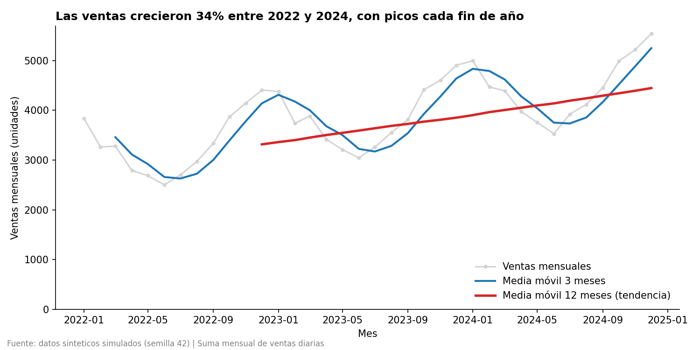
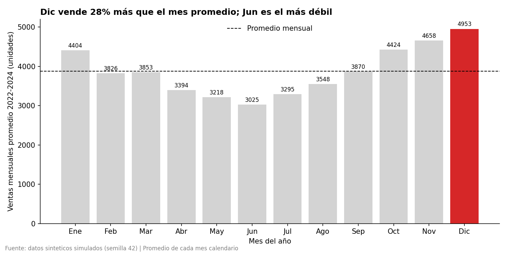
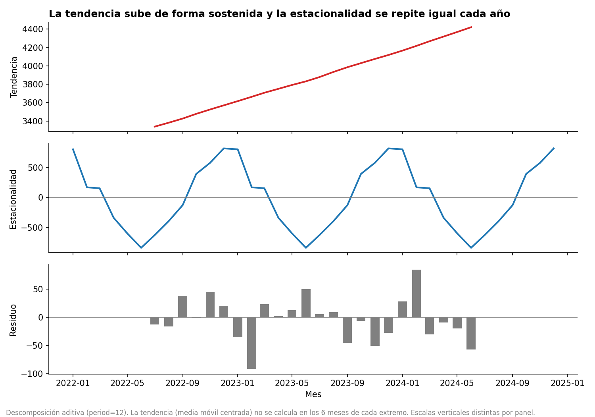

# Semana XX — Series temporales, visualización y optimización

**Autor:** Iker_Yulian_Santiago_Castro (@ikeryulian)  
**Curso:** IkerYulian **Fecha:** 2 de noviembre de 2026

## Contenido

| Archivo | Descripción |
|---|---|
| `serie_temporal.py` | `resample` mensual, medias móviles (3 y 12 meses), descomposición y 3 gráficos |
| `datos_diarios.csv` / `serie_mensual.csv` | Serie diaria de entrada y serie mensual resultante |
| `img/` | `01_evolucion.png`, `02_comparacion.png`, `03_descomposicion.png` |
| `setup_datos.sql`, `optimizacion.sql`, `evidencia_explain.txt` | Optimización SQL (PostgreSQL 16) con `EXPLAIN ANALYZE` real |
| `medidas_dax.md` | 2 medidas DAX relacionadas con el indicador |
| `requirements.txt` | Dependencias de Python |

**Ejecutar:** `pip install -r requirements.txt && python serie_temporal.py`

## 1. Serie temporal: resample + media móvil

**Datos.** Serie diaria de ventas (2022-01-01 a 2024-12-31, 1 096 observaciones). Son **datos sintéticos
reproducibles** (semilla 42) construidos con tendencia lineal + estacionalidad anual + ruido, por lo que la
estructura que se encuentra es la que se programó. Para usar datos reales basta definir `CSV_REAL` en el script.

**Método.**
- `serie.resample("MS").sum()` agrega los datos diarios a ventas mensuales.
- `rolling(3).mean()` suaviza el corto plazo; `rolling(12).mean()` cubre un ciclo estacional completo,
  por lo que **elimina la estacionalidad** y deja la tendencia.
- `seasonal_decompose(model="additive", period=12)` separa tendencia, estacionalidad y residuo.

**Resultados (salida real del script).**

| Indicador | Valor |
|---|---|
| Ventas anuales 2022 / 2023 / 2024 | 39 795 / 46 234 / 53 375 |
| Crecimiento 2022 → 2024 | **+34,1 %** |
| Media móvil 12 m (dic-2022 → dic-2024) | 3 316 → 4 448 (+34,1 %) |
| Mes pico (promedio) | Diciembre: 4 953 (**+27,9 %** sobre el promedio) |
| Mes valle (promedio) | Junio: 3 025 (**−21,9 %** bajo el promedio) |
| Amplitud estacional pico-valle | 1 652 unidades/mes |
| Fuerza de estacionalidad | ≈ 1,0 (escala 0–1) |

**Interpretación.**
- **Tendencia:** creciente y casi lineal; la MM12 sube de forma continua sin quiebres.
- **Estacionalidad:** ciclo anual estable con máximo en diciembre–enero y mínimo en junio. Se repite con la
  misma forma y amplitud en los tres años, y el residuo es pequeño frente a la señal.
- **Limitación:** `sum()` mensual depende del número de días (febrero tiene menos), lo que explica parte de
  la caída de febrero. Para una comparación estricta se puede usar `.mean()` diario.

## 2. Visualizaciones

**Gráfico 1 — Evolución (líneas).** Una línea es la forma adecuada para mostrar cambio en el tiempo.
Superpone la serie mensual (gris, contexto), la MM3 (azul) y la MM12 (rojo, la tendencia).
*Honestidad:* el eje Y parte de 0, hay unidades en los ejes, se declara la fuente y el título expresa la conclusión.

**Gráfico 2 — Comparación (barras).** Las barras comparan magnitudes entre categorías (meses calendario).
*Honestidad:* eje desde 0 (obligatorio en barras), valores exactos rotulados, línea del promedio como referencia y
color solo en diciembre para dirigir la atención; el título enuncia el hallazgo.

**Gráfico extra — Descomposición.** Respalda la interpretación: separa la tendencia (sube), la estacionalidad
(se repite igual cada año) y el residuo (pequeño). Cada panel tiene escala propia, indicado en el pie.

## 3. Optimización SQL

**Indicador relacionado:** ventas mensuales de un año (equivale al `resample("MS").sum()` del punto 1).
Prueba con **3 000 000 de filas** en PostgreSQL 16 (`setup_datos.sql`).

**Problema.** `WHERE EXTRACT(YEAR FROM fecha) = 2024` aplica una función a la columna, por lo que la consulta no
es *sargable*: el motor no puede usar un índice sobre `fecha` y lee toda la tabla.

**Solución.** (1) Filtrar por rango `fecha >= '2024-01-01' AND fecha < '2025-01-01'`;
(2) crear el índice cubriente `CREATE INDEX ... ON ventas (fecha) INCLUDE (monto)`;
(3) agrupar con `date_trunc('month', fecha)`.

| Variante | Plan | Tiempo* |
|---|---|---|
| Original (EXTRACT) | Seq Scan | 578,6 ms |
| Original + índice (el índice se ignora) | Seq Scan | 538,6 ms |
| Solo rango sargable | Seq Scan | 346,2 ms |
| **Rango + índice cubriente** | **Index Only Scan** (Heap Fetches: 0) | **214,6 ms** |

\*Mejor de 3 ejecuciones con caché caliente. **Mejora: 2,7× más rápida**, y las páginas leídas bajan de 19 109 a
2 305 (−88 %). El resultado es idéntico (66 070 130,94 en ambas). Salida completa en `evidencia_explain.txt`.

*Nota:* la ganancia es moderada porque 2024 es el 20 % de la tabla; con filtros más selectivos (un mes) el índice
rinde mucho más.

## 4. Medidas DAX

`Ventas Totales` (métrica base) y `Ventas MM 3M` (media móvil de 3 meses que reproduce `rolling(3)` de pandas,
devolviendo BLANK cuando la ventana está incompleta). Código, explicación y valores de validación en
[`medidas_dax.md`](medidas_dax.md).

## Findings

The daily sales series was aggregated to monthly totals with `resample("MS")` and shows a clear upward trend:
annual sales grew 34% between 2022 and 2024, from 39,795 to 53,375 units. The 12-month moving average rises
smoothly from about 3,300 to 4,450 units per month, which confirms that growth once the seasonal effect is
removed, while the 3-month moving average follows the short-term swings more closely. The series also has strong,
stable yearly seasonality: sales peak in December (about 28% above the average month), stay high in January, and
bottom out in June (about 22% below average), a gap of roughly 1,650 units between the seasonal peak and trough.
The first chart (line chart) shows the evolution of monthly sales together with both moving averages, and its
y-axis starts at zero so the growth is not exaggerated. The second chart (bar chart) compares the average sales of
each calendar month, highlighting December as the strongest month, with a dashed line marking the overall monthly
average. Together, the charts suggest that the business is growing steadily and that inventory and staffing should
be planned around the year-end peak; note that the data are synthetic, so these patterns reflect the simulated
structure rather than a real business.

## Referencias

- pandas. [`DataFrame.resample`](https://pandas.pydata.org/docs/reference/api/pandas.DataFrame.resample.html) y [`DataFrame.rolling`](https://pandas.pydata.org/docs/reference/api/pandas.DataFrame.rolling.html).
- statsmodels. [`seasonal_decompose`](https://www.statsmodels.org/stable/generated/statsmodels.tsa.seasonal.seasonal_decompose.html).
- Hyndman, R. J., & Athanasopoulos, G. (2021). *Forecasting: Principles and Practice* (3.ª ed.). OTexts. https://otexts.com/fpp3/ (descomposición, medias móviles, fuerza de estacionalidad).
- Cairo, A. (2016). *The Truthful Art*. New Riders. (ejes honestos, integridad gráfica).
- Knaflic, C. N. (2015). *Storytelling with Data*. Wiley. (títulos que expresan la conclusión).
- Matplotlib. https://matplotlib.org/stable/
- PostgreSQL Documentation. [Using EXPLAIN](https://www.postgresql.org/docs/current/using-explain.html) y [Index-Only Scans and Covering Indexes](https://www.postgresql.org/docs/current/indexes-index-only-scans.html).
- Winand, M. *Use The Index, Luke*. https://use-the-index-luke.com/ (consultas sargables).
- Microsoft Learn. [`DATESINPERIOD`](https://learn.microsoft.com/en-us/dax/datesinperiod-function-dax), [`REMOVEFILTERS`](https://learn.microsoft.com/en-us/dax/removefilters-function-dax), [`CALENDAR`](https://learn.microsoft.com/en-us/dax/calendar-function-dax).
